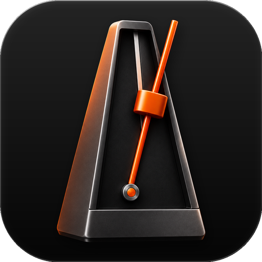
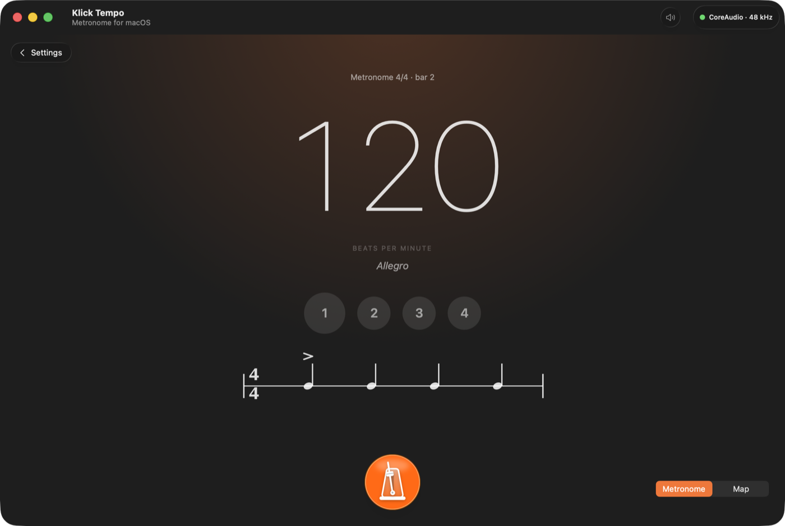
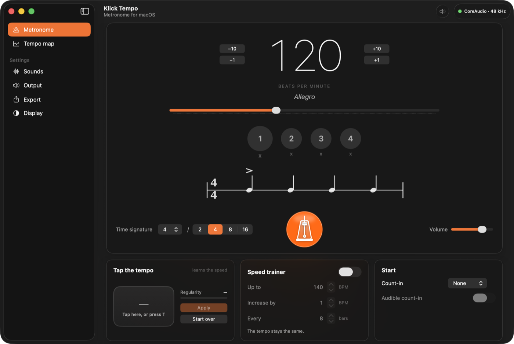
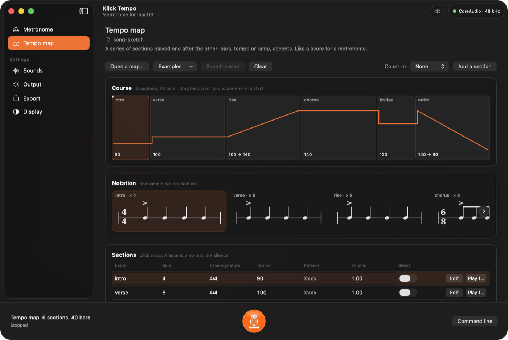
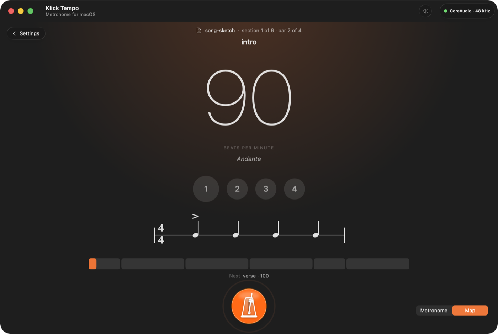
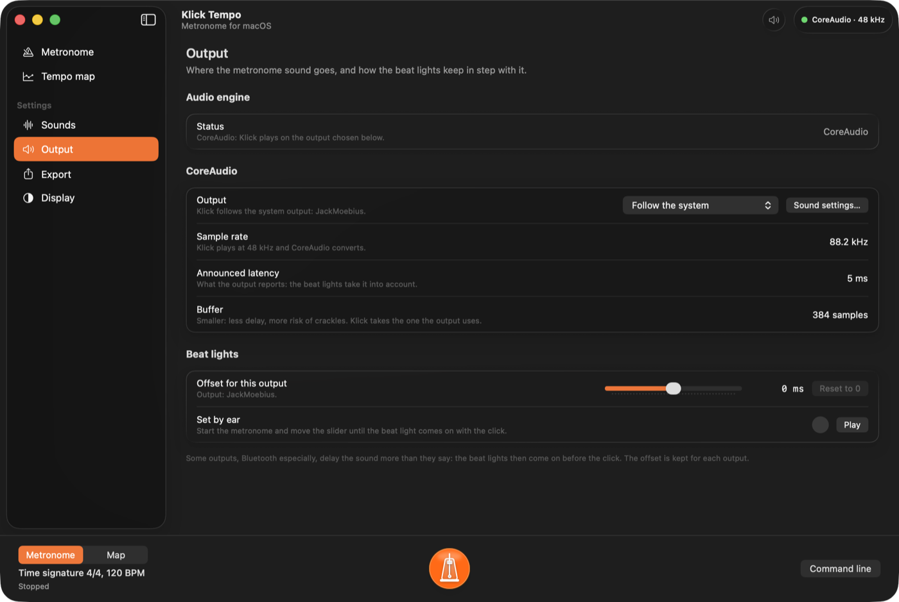
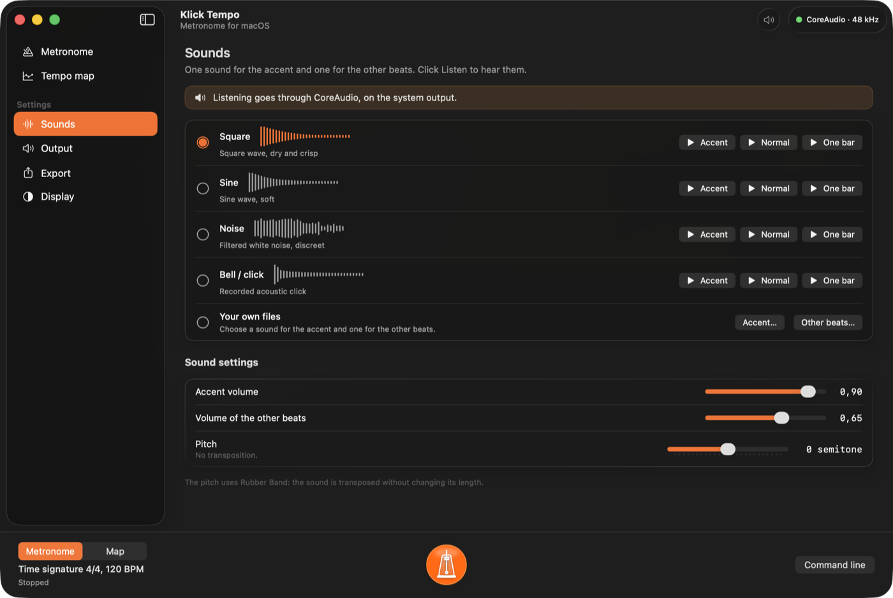
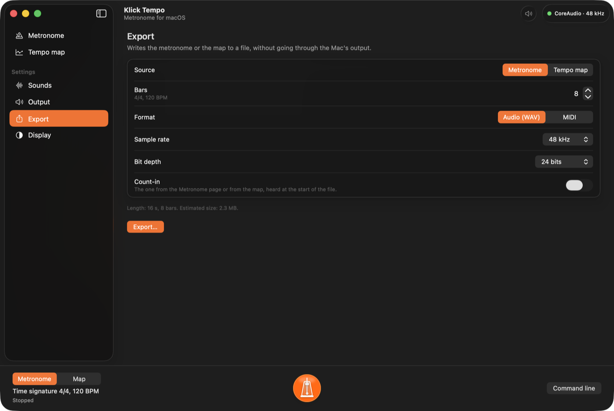
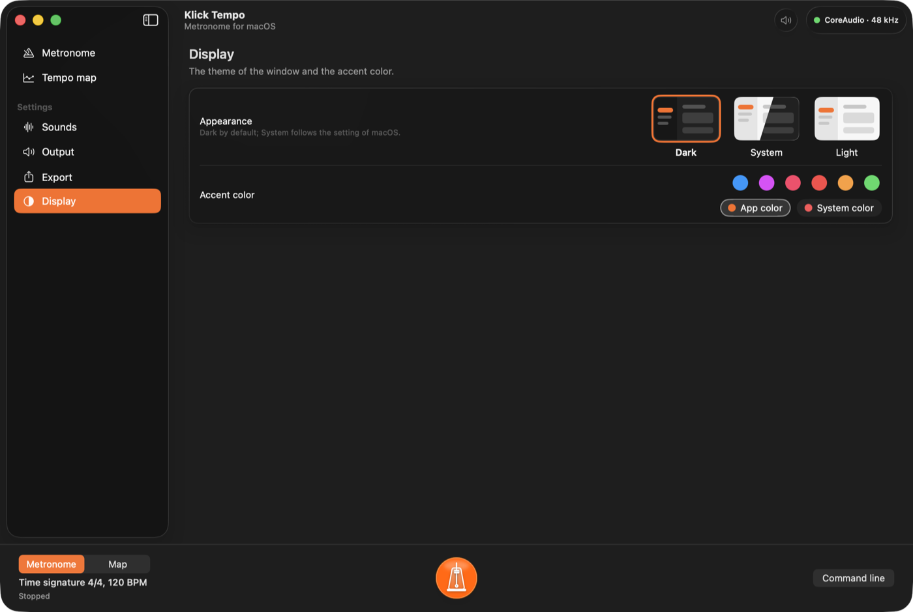

<div align="center">

  
  <h1>Klick Tempo</h1>
  <p>A metronome for Mac with tempo maps, built on <code>klick</code> by Dominic Sacré.</p>
  <p>
    
    <strong>Signed &amp; notarized by Apple</strong>
  </p>

  
  
  
  [](https://www.buymeacoffee.com/zinc75)

  

</div>

---

A metronome that does what a practice session needs: a steady click, a tempo you can tap, a speed trainer, and tempo maps that follow a whole piece with its changes of meter and tempo. It plays on the output of your Mac, with the click engine of `klick`, built here for macOS and embedded in the application.

Klick Tempo is an unofficial interface. It does not need JACK. A version with JACK support, which also installs the `klick` command-line program, is part of [Jack Apps Collection for macOS](https://github.com/zinc75/jack-apps-collection-macos/tree/main/klick).

## Install

Download `KlickTempo-0.13.0-macOS-3.pkg` from the [Releases](https://github.com/zinc75/klick-tempo/releases) page and open it. The package is signed and notarized by Apple, so it opens without any Gatekeeper warning. It installs `Klick Tempo.app` in `/Applications`.

It needs macOS 15 or later. To build from source instead, see [`klick/swiftui/README.md`](klick/swiftui/README.md).

## The metronome

Tempo from 30 to 260 BPM with a slider, buttons or the arrow keys, any meter, an accent or a silence on each beat, a count-in, and a speed trainer that raises the tempo by a step every few bars up to a target. Tap the tempo with a key or on the trackpad. A simplified view shows only the tempo, the beats and the notation while you play.

<div align="center">
  
</div>

## Tempo maps

A map is a text file with one line per section: its bars, meter, tempo or tempo ramp, accents and volume. Open one, edit its sections in the table, start from any section, and follow the course of the tempo on the timeline. The format is the one of `klick`, so maps written for it work here.

<div align="center">
  
</div>

While a map plays, the simplified view shows the section, the bar and the next section.

<div align="center">
  
</div>

## Sounds, output, export, display

Square, sine, noise and click sounds, with a pitch and a volume for the accent and for the other beats, or your own files. The beat lights are shifted by the latency of the output, and the offset can be set by ear for outputs that delay the sound more than they say, Bluetooth especially. A metronome or a map can also be written to an audio file (WAV) or to a MIDI file. The window is dark by default, and follows the system or stays light if you prefer; the accent color can be changed.

<div align="center">
<table>
<tr>
<td align="center"><br><sub>Output</sub></td>
<td align="center"><br><sub>Sounds</sub></td>
</tr>
<tr>
<td align="center"><br><sub>Export to WAV or MIDI</sub></td>
<td align="center"><br><sub>Display</sub></td>
</tr>
</table>
</div>

The interface is in French, English, German, Italian and Spanish. The German, Italian and Spanish translations have not been reviewed by native speakers.

## Uninstall

There is no uninstaller. To remove what the package installed:

```
sudo rm -rf "/Applications/Klick Tempo.app"
sudo pkgutil --forget io.github.zinc75.klicktempo.pkg
```

The settings are in `~/Library/Preferences/io.github.zinc75.klicktempo.plist`; `defaults delete io.github.zinc75.klicktempo` removes them. Your maps are not touched.

## Support

Klick Tempo is free and open source. If it saves you time, you can buy me a coffee: it helps pay the Apple Developer account ($99 a year) that keeps the installers signed and notarized.

[](https://www.buymeacoffee.com/zinc75)

## Upstream

| | |
|---|---|
| Project | klick |
| Author | Dominic Sacré |
| Source | https://github.com/dsacre/klick |
| Version | commit `c05071081165e2bab66fb839a128925cd361d939` (2015-03-29, branch `master`), `SConstruct` says 0.13.0-pre |
| Copy here | `klick/upstream/` = a Git submodule of the repository above, at the commit above, **unmodified** (clone with `--recurse-submodules`) |

## Licence

GPL-2.0-or-later, as `klick`. The libraries linked into the application (libsndfile and its codecs, libsamplerate, Rubber Band) have their own licences, listed in the application and in the package.

## State on macOS

Klick Tempo runs on arm64 and x86_64. The engine of `klick` is built from the upstream sources and five small patches (`klick/patches/`), linked statically, with a CoreAudio output. Nothing in it needs JACK.

Tested on macOS, on arm64 and on x86_64 (under Rosetta).

## Layout

- `klick/upstream/`: the original sources, never edited.
- `klick/patches/`: changes to the upstream sources, as unified diffs.
- `klick/engine/`: the engine as a library, with its C interface and its tests.
- `klick/swiftui/`: the application, with its tests and build script.
- `libs/`: the libraries built for it, each a Git submodule at the tag of its release, with the script that builds it.
- `screenshots/`: the images of this README.
